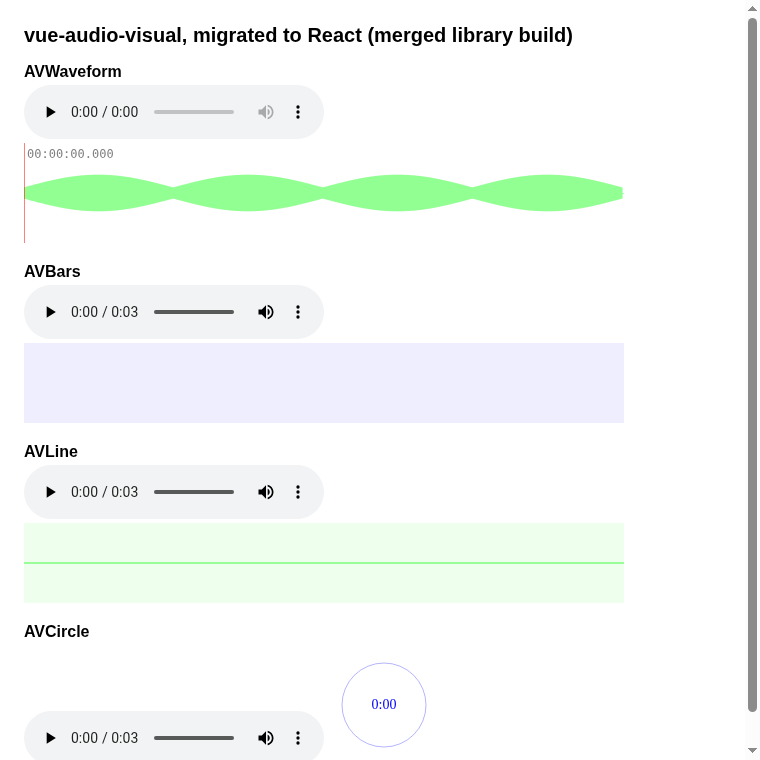

# react-audio-visual

React audio visualization components (bars, circle, line, waveform, media stream), migrated from
the Vue library [vue-audio-visual](https://github.com/staskobzar/vue-audio-visual) by Stas Kobzar
(commit `d2cbf3c`).



## How it was made

The migration was done by an LLM (gpt-6-luna), not by hand, as an exploration in a master's
thesis on test-based evaluation of LLM-supported code migration between React and Vue.

1. The library was split into 8 tasks: the components `AVBars`, `AVCircle`, `AVLine`,
   `AVWaveform`, `AVMedia` and the hooks `useAVMedia`, `useAudioContext`, `useCanvasContext`.
   Each task is one symbol with its dependencies, migrated against its original tests ported to
   React Testing Library.
2. Every task passed its tests on its own (24 of 24 runs). Merging the per-task outputs file by
   file passed only 34 of 41 tests, because the tasks had migrated the shared hooks with
   incompatible APIs.
3. Migrating bottom-up fixed that: the shared `useCanvasContext` and `utils` were kept from one
   run, and only `useAVMedia` was migrated again on top of them. The result is this repository.

The code is published as the model produced it, apart from build configuration and this README.
The plugin entry `AVPlugin` of the Vue library has no React counterpart and is not included; the
tests of the drawing functions were not ported.

## Status

- 41 of 41 tests pass (`npm test`), library typecheck is clean, the library build works.
- Not published to npm. Not reviewed beyond the tests and a visual check in the demo.

## Usage

```tsx
import { AVBars, AVWaveform } from 'react-audio-visual';

<AVWaveform src="/sound.mp3" canvWidth={600} canvHeight={100} />
<AVBars src="/sound.mp3" barColor="#00f" />
```

Exports: `AVBars`, `AVCircle`, `AVLine`, `AVWaveform`, `AVMedia` and the hooks `useAVBars`,
`useAVCircle`, `useAVLine`, `useAVWaveform`, `useAVMedia`. Props follow the original library.

## Development

```bash
npm install
npm test
npm run typecheck
npm run build
npm run demo
```

## License

MIT, see [LICENSE](LICENSE). Original work copyright Stas Kobzar.
